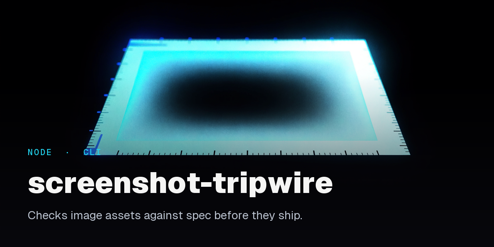

<p align="center"></p>

# screenshot-tripwire

Pattern-checker for marketing image assets. Sibling to [`trailer-tripwire`](https://github.com/EthanY33/trailer-tripwire). Catches measurable AI-default tells before they ship: wrong Steam capsule dimensions, transparent corners, monochrome flat palettes, blank frames, and over-compression.

This is a **pattern checker**, not a taste checker. It catches mistakes; it does not know whether the asset is compelling.

## Why

Steam silently rejects RGBA marketing assets with transparent corners. Capsules at the wrong dimensions get auto-resized into mush. AI-generated mood-boards land at one hue family and one tone. Over-compressed JPEGs upload but look terrible. None of these failures are caught by your eyes alone, especially under launch pressure. This tool fails the build before the bad asset reaches production.

## Install

```bash
# As a devDependency, pinned to a specific commit (matches trailer-tripwire pattern)
npm install --save-dev https://github.com/EthanY33/screenshot-tripwire/archive/<commit-sha>.tar.gz

# Or directly via the registry once published (not yet)
npm install --save-dev screenshot-tripwire
```

## Usage

```bash
# Audit specific files
npx screenshot-tripwire audit path/to/cover.png path/to/header.png

# JSON output (for piping into another tool)
npx screenshot-tripwire audit --json path/to/cover.png

# Audit everything currently staged under brand/goneidle-landing/
npx screenshot-tripwire check

# Install pre-commit hook (shares the hook with trailer-tripwire and copy-tripwire)
npx screenshot-tripwire install-hooks

# Short alias
npx st audit cover.png
```

Wire into your project's `package.json`:

```json
{
  "scripts": {
    "screenshot:audit": "screenshot-tripwire audit",
    "screenshot:check": "screenshot-tripwire check",
    "screenshot:install-hooks": "screenshot-tripwire install-hooks"
  }
}
```

Exit codes: `0` if no CRITICAL findings, `2` if any CRITICAL.

## Heuristics

| Code | Level | Catches |
|---|---|---|
| `TINY_FILE` | CRITICAL | <5 KB → empty/corrupted |
| `STEAM_DIMS` | CRITICAL | Filename matches a Steam asset slot but dims aren't canonical OR @2x |
| `TRANSPARENT_CORNER` | CRITICAL | Any of 4 corners has alpha < 255 (Steam rejects RGBA marketing assets). Not applied to `library_logo*` |
| `NO_HUE` | CRITICAL | Image is grey/black/white only (zero hue families above noise) |
| `TOO_DARK` / `TOO_BRIGHT` | CRITICAL | Mean luminance < 0.04 or > 0.96 (effectively blank) |
| `DECODE_FAIL` | CRITICAL | pngjs/jpeg-js decode failed, or a PNG is over the 64 MP decode limit or the decode memory budget (16-bit PNGs hit it first), or has a side of 0 or over 65,535 px |
| `MONOCHROME_FLAT` | WARN | 1 hue family + flat tonality (lum spread < 0.10), a common AI mood-board tell |
| `FLAT_TONALITY` | WARN | p05-p95 luminance spread < 0.05 |
| `OVER_COMPRESSED` | WARN | Heavy compression for resolution |
| `ODD_ASPECT` | WARN | Not 16:9 / 4:3 / 1:1 / 21:9 (when no Steam slot match) |
| `LOW_HUE_DIVERSITY` | NOTE | 1-2 hue families on a brand-cohesive image (informational) |

### Recognized Steam asset slots

Filename is matched against patterns to detect which Steam asset slot the image is for. Both canonical and `@2x` retina sizes are accepted.

| Pattern | Slot | Canonical dims |
|---|---|---|
| `capsule_header*` / `*_capsule_header` | header capsule | 460×215 |
| `capsule_main*` / `*_capsule_main` | main capsule | 616×353 |
| `capsule_vertical*` / `*_capsule_vertical` | vertical capsule | 374×448 |
| `library_hero*` / `*_library_hero` | library hero | 3840×1240 |
| `library_logo*` / `*_library_logo` | library logo | 1280×720 |
| `screenshot_<n>` / `*_screenshot_<n>` / `screen_cap*` | Steam screenshot | 1920×1080 |
| `page_bg*` / `page_background*` | page background | (any) |

The library logo is the one slot Steam wants on a transparent background, so `library_logo*` is exempt from `TRANSPARENT_CORNER`. When such a file has transparent pixels, the color and luminance checks (`NO_HUE`, `TOO_DARK`, `TOO_BRIGHT`, `MONOCHROME_FLAT`, `FLAT_TONALITY`, `LOW_HUE_DIVERSITY`) are skipped too, because a white, black or one-color logo is valid. A fully transparent logo is still CRITICAL (`NO_HUE`). Every other slot keeps all checks.

## Pre-commit hook

The `install-hooks` command writes the `pre-commit` hook in the directory git actually uses (`git rev-parse --git-path hooks`, so `core.hooksPath` and linked worktrees work) that audits any staged `.png` / `.jpg` / `.jpeg` files under `brand/goneidle-landing/` and blocks the commit on any CRITICAL finding.

The gate is a managed block between `# screenshot-tripwire:v1` and `# screenshot-tripwire:v1 end`, running `npx --no -- screenshot-tripwire check || exit $?`. `--no` stops npx from downloading anything from the registry, and `|| exit $?` blocks the commit even when the hook has no `set -e`. The installer is **idempotent** and rewrites only the lines between its own markers. Blocks from `trailer-tripwire` and `copy-tripwire` live in the same file and are never touched, in any install order. Old single-tool and composed hooks written by earlier versions are migrated with every gate they had. It **refuses to modify** an unrelated pre-commit hook and prints the block to add by hand.

To bypass on a one-off: `git commit --no-verify` and document why in the message.

## Adapting heuristics

Heuristics live in `lib/audit.mjs`. Tune thresholds when:
- A real, intentionally-cohesive brand asset trips a CRITICAL → downgrade to WARN
- A bad asset slips through → tighten threshold OR add a new heuristic with a new code

The Steam asset slot detector is opinionated. Adapt the patterns to match your filename conventions.

## Roadmap

- `--ref <ref-image>` mode (mirror trailer-tripwire) to compare against an ingested reference profile
- Animated GIF / WebP support (currently PNG + JPEG only)
- Optional: Lighthouse-style perceptual quality score
- Programmatic Node API (the lib modules are already importable, just not formally documented)

## License

MIT, see [LICENSE](LICENSE).
